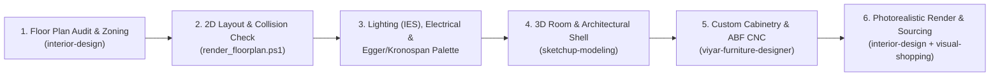

# SketchUp, Architecture & Design Agent Skills (`sketsh-up-skills`)

A unified collection of AI Agent Skills (`SKILL.md` format for **Google Antigravity**, **Claude Code**, and **Cursor**) covering **Interior Design & Architectural Space Planning**, **3D Modeling & Ruby API Scripting in SketchUp**, **Parametric Custom Furniture Engineering (ABF Solutions & Viyar)**, **Visual Product Sourcing**, and **UI/Visual Design Systems**.

---

## Included Skills Catalog

### 1. Architecture, Interior Design & 3D SketchUp Engineering

| Skill | Path | Description |
| :--- | :--- | :--- |
| **`interior-design`** | [`skills/interior-design`](./skills/interior-design/SKILL.md) | Comprehensive architectural space planning, room layout ergonomics (Neufert / ASID / NCIDQ), systematic floor plan auditing, multi-layered lighting design (IES standards), electrical switch/socket placement, 60-30-10 color/material palettes mapped to **Egger & Kronospan** decors, automated 2D SVG/HTML floorplan generation with collision checking, and SketchUp-to-AI photorealistic rendering workflows. |
| **`viyar-furniture-designer`** | [`skills/viyar-furniture-designer`](./skills/viyar-furniture-designer/SKILL.md) | Parametric 3D furniture engineering in **SketchUp (`.skp`)** following **ABF Solutions (`ABF`)** standards (`__<PartNumber>` board naming, `Layer0` / `Facade` / `Внутрішній фасад` layering, official Viyar material codes, 3D CNC Minifix/Confirmat/Hinge fasteners), plus native C# `.skp` exporter (`src/`), SketchUp Ruby live sync bridge (`sketchup_plugin/`), and on-demand Viyar conversion. |
| **`sketchup-modeling`** | [`skills/sketchup-modeling`](./skills/sketchup-modeling/SKILL.md) | 3D architectural room & building modeling in SketchUp, SketchUp Ruby API (`.rb`) development rules, manifold solid geometry rules, architectural tag/layer hierarchy, and automated scene/camera setup for presentations and rendering. |
| **`visual-shopping`** | [`skills/visual-shopping`](./skills/visual-shopping/SKILL.md) | Visual search for in-stock furniture, lighting fixtures, decor, and apparel across online stores from reference renders, moodboards, or screenshots. |

---

### 2. Visual, Brand & Interface Design Skills

| Skill | Path | Description |
| :--- | :--- | :--- |
| **`design`** | [`skills/design`](./skills/design/SKILL.md) | Comprehensive visual design: brand identity, design tokens, logo generation, corporate identity mockups, banners, and icons. |
| **`design-system`** | [`skills/design-system`](./skills/design-system/SKILL.md) | Three-layer design token architecture (primitive -> semantic -> component), spacing/typography scales, and presentation decks. |
| **`ui-ux-pro-max`** | [`skills/ui-ux-pro-max`](./skills/ui-ux-pro-max/SKILL.md) | Searchable design intelligence across 80+ visual styles, 192 color palettes, 74 font pairings, and UX guidelines. |
| **`ui-styling`** | [`skills/ui-styling`](./skills/ui-styling/SKILL.md) | Component styling, responsive grid layouts, dark/light theming, and canvas-based visual compositions. |
| **`frontend-design`** | [`skills/frontend-design`](./skills/frontend-design/SKILL.md) | Aesthetic direction, editorial typography, and intentional layout composition. |
| **`banner-design`** | [`skills/banner-design`](./skills/banner-design/SKILL.md) | Art direction and banner generation across 22 visual styles. |
| **`web-design-guidelines`** | [`skills/web-design-guidelines`](./skills/web-design-guidelines/SKILL.md) | Accessibility, ergonomics, and visual hierarchy audit rules. |

---

## End-to-End Architectural & SketchUp Workflow



---

## Quick Installation

Run the included PowerShell installer to copy all skills into your global Antigravity skills directory (`~/.gemini/config/skills/`):

```powershell
powershell.exe -NoProfile -ExecutionPolicy Bypass -File .\install.ps1
```

Or install into a specific project workspace (`.agents/skills/`):

```powershell
powershell.exe -NoProfile -ExecutionPolicy Bypass -File .\install.ps1 -TargetDir "D:\Path\To\Your\Project\.agents\skills"
```
