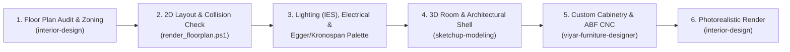

# SketchUp, Architecture & Interior Design Skills (`sketsh-up-skills`)

A specialized collection of AI Agent Skills (`SKILL.md` format) focused exclusively on **Architectural Space Planning**, **Interior Design**, **3D Architectural Modeling in SketchUp**, and **Parametric Custom Furniture Engineering (ABF Solutions & Viyar)**.

---

## Included Skills

| Skill | Path | Description |
| :--- | :--- | :--- |
| **`interior-design`** | [`skills/interior-design`](./skills/interior-design/SKILL.md) | Comprehensive architectural space planning, room layout ergonomics (Neufert / ASID / NCIDQ), systematic floor plan auditing, multi-layered lighting design (IES standards), electrical switch/socket placement, 60-30-10 color/material palettes mapped to **Egger & Kronospan** decors, automated 2D SVG/HTML floorplan generation with collision checking, and SketchUp-to-AI photorealistic rendering workflows. |
| **`sketchup-modeling`** | [`skills/sketchup-modeling`](./skills/sketchup-modeling/SKILL.md) | 3D architectural room & building modeling in SketchUp (`.skp`), SketchUp Ruby API (`.rb`) development rules, manifold solid geometry rules, architectural tag/layer hierarchy, and automated scene/camera setup for technical drawings and rendering. |
| **`viyar-furniture-designer`** | [`skills/viyar-furniture-designer`](./skills/viyar-furniture-designer/SKILL.md) | Parametric 3D furniture and wall-panel engineering in **SketchUp (`.skp`)** following **ABF Solutions (`ABF`)** standards (`__<PartNumber>` board naming, `Layer0` / `Facade` / `Внутрішній фасад` layering, official Viyar material codes, 3D CNC Minifix/Confirmat/Hinge fasteners), plus native C# `.skp` exporter (`src/`), SketchUp Ruby live sync bridge (`sketchup_plugin/`), and on-demand Viyar conversion. |

---

## End-to-End Architectural & SketchUp Workflow



---

## Quick Installation

Run the included PowerShell installer to copy the skills into your global Antigravity skills directory (`~/.gemini/config/skills/`):

```powershell
powershell.exe -NoProfile -ExecutionPolicy Bypass -File .\install.ps1
```

Or install into a specific project workspace (`.agents/skills/`):

```powershell
powershell.exe -NoProfile -ExecutionPolicy Bypass -File .\install.ps1 -TargetDir "D:\Path\To\Your\Project\.agents\skills"
```
